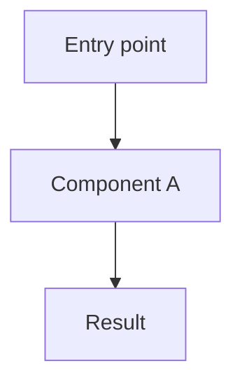

# AI Agent Guidelines

**This document tells AI agents how to work in this knowledge base.**

Read this before starting any task. Follow it exactly.

---

## What This Repo Is

A personal engineering knowledge base for [OWNER]. It contains:

- **Project docs** — research, RFCs, implementation plans, POC simulations, PR plans for specific features
- **Workflow docs** — reusable process guides for how to collaborate on engineering tasks
- **Templates** — starting points for new project docs

This is not a code repo. There is no build, no tests, no linter. The artifacts here are **written documents** that must be accurate, grounded in real code, and useful to future readers (including future AI sessions).

---

## Repo Structure

```
README.md                             ← master index — update this when adding a project
projects/
  YYYY-NNN-<project-name>/            ← one folder per feature/topic
    01-research.md                    ← Phase 1: codebase assessment
    02-rfc.md                         ← Phase 3: design document
    03-impl-plan.md                   ← Phase 6: implementation plan (kept live)
    04-poc-simulation.md              ← Phase 4: proof of concept (optional)
    05-pr-plan.md                     ← Phase 9: PR sequence plan
workflows/
  ai-engineer-collaboration.md       ← the end-to-end workflow guide
templates/
  01-research.md                     ← copy to start a new research doc
  02-rfc.md                          ← copy to start a new RFC
  03-impl-plan.md                    ← copy to start a new impl plan
  04-poc-simulation.md               ← copy to start a new POC
  05-pr-plan.md                      ← copy to start a new PR plan
```

### Project folder naming

Format: `YYYY-NNN-<project-name>`

- `YYYY` = year the project started
- `NNN` = 3-digit sequence number, incrementing within the year (001, 002, ...)
- `<project-name>` = lowercase, hyphen-separated name

Example: `2026-001-payment-refactor`

To find the next number: look at the highest `NNN` in `README.md` for the current year, add 1.

---

## The Workflow You Must Follow

Read [`workflows/ai-engineer-collaboration.md`](./workflows/ai-engineer-collaboration.md) in full before starting any project work. The phases below are a summary — the full doc has the details.

| Phase | Name | Your role | Output doc | Exit condition |
|---|---|---|---|---|
| 0 | Problem Framing | Listener — confirm you understood the problem | Agreed problem statement | Problem statement written and agreed |
| 1 | Assessment / Research | Codebase explorer — read first, write second | `01-research.md` | Research doc has actual code references (file + line) |
| 2 | Ideation | Options presenter — at least 3 approaches with tradeoffs | Section in research doc | **`## Approach Selection Log` filled** — options, rejections with category, chosen approach, decided by |
| 3 | RFC Writing | Author — full design doc | `02-rfc.md` | **Every rejected alternative has a rejection category and revisit condition** |
| 4 | POC / Simulation | Proof builder — does the mechanism actually work? (optional) | `04-poc-simulation.md` (if needed) | POC answers the stated question; divergences from production noted |
| 5 | Pre-conditions | Risk enumerator — list every P0 blocking question | Section in impl plan | **Every P0 has Decision + `Decided by` = `[OWNER] confirmed`/`[OWNER] chose`** |
| 6 | Implementation Planning | Task decomposer — ordered phases with definitions of done | `03-impl-plan.md` | Momus reviewed; all P0s resolved |
| 7 | Implementation | Code author — phase by phase, honest reporting | (code commits) | **`## Design Pivots` up to date; RFC updated if pivot is significant** |
| 8 | Verification | Verifier — gap analysis, not just "tests pass" | Section in impl plan | Gap analysis complete |
| 9 | PR Planning | Sequence planner — split for reviewability | `05-pr-plan.md` | PR plan written with merge sequence |

**Phase exit conditions are not optional.** Do not move to the next phase until the exit condition for the current phase is met.

---

## Diagrams

**All diagrams must use Mermaid.** Never use ASCII art or plain-text box-and-arrow drawings.

Use a fenced code block with the `mermaid` language tag:

````markdown

````

**Choose the right diagram type:**

| Situation | Mermaid type |
|---|---|
| Request/data flow, constructor logic, branching paths | `flowchart TD` (top-down) or `flowchart LR` (left-right) |
| Class structure, inheritance, composition | `classDiagram` |
| Sequence of calls between components | `sequenceDiagram` |
| State machine or lifecycle | `stateDiagram-v2` |
| Phase timeline or Gantt | `gantt` |

When in doubt, use `flowchart TD`.

---

## Rules for Writing Docs

### Write for a human reader, not a template checker

Every section in a document answers a question the reader arrives with. Write to answer that question — then stop. If a section wouldn't change what the reader understands or does, it should not exist.

**Reader's question per section:**

| Section | What the reader needs |
|---|---|
| Problem Statement | What is the mechanism that fails, and what goes wrong because of it? |
| Solution Design | What is the non-obvious insight that makes this solution the right one? |
| Alternatives Considered | Why couldn't you use the simpler approach? |
| Implementation Learnings | What was wrong about the plan, and what did reality correct? |

**Problem statements are causal chains.** Name the specific code path, explain what it does wrong, trace that to the consequence. A reader should be able to verify or refute the problem by reading the referenced code.

Wrong: "Validation does not handle some edge cases correctly."  
Right: "`validateIDNumber(null, null)` returns `true` unconditionally when `regexName` is null. A product that configures the ID field as required but with no regex can receive a booking with a blank passenger ID."

**Solution design leads with the insight, not the inventory.** The first paragraph of Solution Design answers: *what did you learn about the code that makes this specific solution the right one?* Not "we updated X to do Y" — but "the only place that distinguishes case A from case B is Z, so the fix goes there."

**Use tables when comparison is the point.** Good tables compare things. Use them for:
- Multiple approaches evaluated on the same criteria (Comparison Table in research docs)
- Behavior differences across cases (truth tables, special cases with 3+ rows)
- 4+ parallel items where the grid structure genuinely aids scanning

Do not use tables for:
- Content already stated in prose above it
- Requirements that are just restated success criteria with an ID attached
- Items that would read better as a single sentence

**Sections build on each other.** A well-written RFC is an argument: the Problem Statement establishes what fails, the Context explains the mechanism that produces the failure, the Solution Design explains why the fix works *given that mechanism*. If the Solution Design section would be equally comprehensible without reading the Context, the document does not build — it's parallel sections, not an argument.

**Formatting signals structure but does not create it.** Do not bold terms for emphasis, use a `##` header for a single paragraph, or create a table because it looks thorough. If the same information appears as bullets, then a table, then prose — pick one form and cut the others.

---

### Ground everything in code you actually read

**Never speculate about code behavior.** Every claim about what a class does, what a method returns, or what a pattern exists must be traced back to a file and line you read.

Wrong:
> "The service likely uses a factory pattern for component creation."

Right:
> "`BookingService.java` L112–145 delegates to `PricingCalculator` via constructor injection — no static calls."

If you haven't read a file, say so explicitly and read it before writing anything about it.

---

### Research docs: document what EXISTS before proposing anything

The research doc (`01-research.md`) is a fact-finding artifact. Its job is to answer:
1. What does the code actually do today? (not what you think it does)
2. What patterns already exist that could be extended?
3. What are the specific pain points, with code references?
4. What constraints exist that a naive solution would violate?

**Do not propose solutions in the research doc.** The "Approaches Evaluated" section comes after the facts section. Do not let the solution drive the research.

**Name the absent patterns too.** If a pattern does NOT exist in the codebase, say so explicitly. This saves the next agent from searching for it.

```markdown
**Absent patterns (confirmed not present)**:
- No `sealed class`/`sealed interface` anywhere in the repo
- No generic dispatch registry (e.g. `Map<String, Handler<...>>`) — confirmed by search
```

---

### RFCs: every design decision must trace back to a problem

The RFC is a design document, not a wish list. Before writing any "Solution Design" section, ask: which problem statement does this solve? If it doesn't map to a numbered problem, it doesn't belong.

**Success criteria must be binary.** No "improved" or "better." Each criterion is either met or it isn't.

Wrong:
> "Improved maintainability."

Right:
> "Adding a new notification type requires one new class implementing `NotificationHandler`. No existing files are modified."

**Alternatives Considered is not optional.** Every approach that was rejected must be documented with the honest reason it was rejected. This is the section that saves future engineers from re-evaluating dead ends.

---

### Implementation plans: P0 questions block all code

Before writing a single line of production code, list every question whose answer would change the implementation. These are P0 items.

Format each P0:

| # | Question | Why it blocks | Options | Decision | Decided by | Reasoning |
|---|---|---|---|---|---|---|
| P0-1 | The question | What would fork depending on the answer | A / B / C | ✅ Decision or ⏳ Unresolved | `AI proposed` \| `[OWNER] confirmed` \| `[OWNER] chose` | One sentence — why this option |

**`Decided by` must be `[OWNER] confirmed` or `[OWNER] chose` before implementation starts.** An AI-proposed resolution without explicit sign-off does not unblock Phase 6.

**Do not start implementation until all P0 items are ✅ and every `Decided by` is filled.**

---

### Implementation plans: keep them live

The impl plan is not a spec written before code and abandoned during it. It is a **living document**. When the implementation diverges from the plan — and it will — update the plan to reflect what actually happened and why.

Mark tasks `✅ Complete` as they finish. Mark superseded tasks `✅ Superseded` with the reason.

Document design pivots in the RFC under `## Implementation Learnings`. Example:

> **Original plan**: `CustomResolverA` + `CustomResolverB` as two separate Spring beans
>
> **What actually happened**: Merged into `UnifiedResolver` — a thin wrapper around an existing bean already proven in production. Eliminated ~80 lines of custom code.

---

### POC simulations: one question, one test file

A POC answers ONE question: "Does this technical approach actually work mechanically?"

It is not production code. It does not need:
- Spring context
- Real RPC clients (use stub maps)
- Error handling
- Edge case coverage (add those in the unit tests in Phase 7)

It DOES need:
- Real generated classes (not mocks) — the point is to test against actual code shapes
- At least one test per mechanism (usually 3–5 mechanisms max)
- A clear note on what the production design diverged from the simulation

---

### PR plans: split for reviewability, not convenience

Each PR must be independently reviewable. A reviewer looking at PR 2 should not need to understand PR 3 to evaluate whether PR 2 is correct.

The canonical split for any non-trivial refactor:
1. **Schema/contract changes** — inert additions, no behavior change, unblock everything else
2. **New code without wire-up** — purely additive, easy to review; old code still runs
3. **Wire-up + deletion** — narrow: inject, replace, delete. No new logic.

**Each PR description must state explicitly what it does NOT touch.** This is the most useful sentence in a PR description for a reviewer.

---

## Rules for AI Behavior

### Populate Session PWD on every new doc

When creating any document from a template (project docs or repo/oncall docs), **always fill the Session PWD field before writing anything else**.

The working directory is provided by the AI runtime at session start in the `<env>` block as `Working directory`. Copy it verbatim into:

- `**Session PWD**` row in project doc header tables (`/templates/`)
- `session_pwd:` field in repo template frontmatter (`/repos/templates/`)

This makes it possible to trace which codebase repo was open when a doc was written — critical for debugging stale docs or ambiguous project context.

**Never leave Session PWD blank or set it to a placeholder.** If for some reason the env block is absent, use `unknown` and note it.

---

### Read before writing

Never write a doc section based on what you assume the code does. Read the relevant files first. For large codebases, use parallel agents to explore multiple files simultaneously.

### Show your work

When you make a claim in a doc, include the evidence. File name, method name, line range. If a reviewer can't trace the claim back to code, the claim is speculation.

### Report failures honestly

If tests fail, say so and show the output. If an approach didn't work, document it in the impl plan as superseded and explain why. Never paper over a failure by silently trying something else.

### Don't clean up adjacent code

A refactor task is not a license to improve everything you see. Changes must trace to the stated task. Noise in the diff is noise in the review.

### When you discover something that changes the design, stop and update the doc

If you find during implementation that a P0 assumption was wrong, or that the design needs to change — stop writing code. Update the RFC and impl plan first. Code that diverges silently from the plan is a debt that will confuse the next session.

---

## Decision Preservation Rules

Every decision that could be revisited must be documented at the point of decision, not retrospectively. This is how context survives across sessions.

### What must be documented and when

| Decision point | Where | When |
|---|---|---|
| Approach selection (which option and why others were rejected) | `## Approach Selection Log` in `01-research.md` | Before closing Phase 2 |
| Alternatives rejected in the RFC | `## Alternatives Considered` in `02-rfc.md` | Before the RFC is considered done |
| P0 resolution | P0 table in `03-impl-plan.md` | Before starting Phase 7 |
| Design pivots during implementation | `## Design Pivots` in `03-impl-plan.md` | Immediately when the pivot happens |
| Significant pivots | `## Implementation Learnings` in `02-rfc.md` | Same session as the pivot |

### A decision is not documented until it includes

1. **What was decided**
2. **What the constraints were at the time** (not after the fact)
3. **Why rejected alternatives were rejected** (with rejection category — see below)
4. **Under what conditions a rejected alternative would be worth revisiting**

### Rejection categories

Use these consistently in the Approach Selection Log and Alternatives Considered:

| Category | Meaning | Revisitable? |
|---|---|---|
| `TECHNICAL_INFEASIBLE` | Can't be done given current stack or constraints | Only if constraints change |
| `BREAKS_EXISTING_CONSTRAINT` | Violates an established contract, interface, or team boundary | Only if constraint is lifted |
| `COST_TOO_HIGH` | Technically feasible, wrong effort/risk ratio at this time | Yes — when scope or timeline changes |
| `DEFERRED` | Good idea, wrong time or scope | Yes — explicitly worth revisiting |
| `SUPERSEDED` | Was the plan, replaced mid-implementation | See RFC Implementation Learnings |

### Who decides

- `AI proposed` — the AI suggested a resolution; [OWNER] has not confirmed it
- `[OWNER] confirmed` — [OWNER] reviewed the AI's proposal and agreed
- `[OWNER] chose` — [OWNER] made the call, possibly overriding the AI's suggestion

**`AI proposed` alone does not unblock implementation.** P0 items and approach selections require `[OWNER] confirmed` or `[OWNER] chose`.

---

## Repo Catalog

The `/repos/` directory contains persistent knowledge about each codebase — not tied to any single feature.

**Catalog governance is documented in dedicated files — read these before doing any catalog work:**

- **[`repos/GUIDELINES.md`](./repos/GUIDELINES.md)** — what AI agents can and cannot do in catalog entries: bootstrapping order, `auto:` vs `curated:` section rules, confidence rules, what never to auto-generate
- **[`repos/WORKFLOW.md`](./repos/WORKFLOW.md)** — when to create entries (trigger-based), lifecycle states, drift detection protocol, cross-reference with projects

### Quick reference

```
/repos/<repo-name>/
  index.md       ← stack, entry points, conventions, local dev (fill first)
  topology.md    ← upstream/downstream dependencies (fill second)
  domains.md     ← bounded contexts (list candidates; curated content = human fills)
  onboarding.md  ← guided narrative (fill last, after other three are stable)
  oncall/
    index.md     ← alert map, quick reference, first steps
    <symptom>.md ← one runbook per failure mode (incidents only — never auto-generate)
```

Templates live at `/repos/templates/`.

### When a new entry is created

When you start Phase 1 research on a project targeting a repo with no catalog entry: create the entry during that session. The reading you do for Phase 1 is the basis for the `auto:` sections. Do not pre-populate repos you haven't worked in.

### Cross-referencing

Every `01-research.md` that uses catalog information must declare in frontmatter:
```yaml
catalog_entry: repos/<repo-name>/
catalog_verified_commit: <sha>
```

---

## Starting a New Project

1. Determine the next folder number from `README.md`
2. Create `projects/YYYY-NNN-<name>/`
3. Copy `templates/01-research.md` → `projects/YYYY-NNN-<name>/01-research.md`
4. Fill in the header fields (Context, Date, Status, **Session PWD**)
5. **Session PWD** — set this to the working directory (`pwd`) where this opencode session was opened. It is injected by the AI runtime in the `<env>` block at session start as `Working directory`. Copy it verbatim.
6. **Read the relevant code before writing anything else**
7. Work through the phases in order — do not skip to RFC before research is done
8. Add a row to the `README.md` Projects table

---

## The Best Example

When working in a docs workspace, look for the most complete project folder. It typically has all 5 doc types (`01-research.md` through `05-pr-plan.md`) and covers the full lifecycle. Read it before starting any non-trivial project — especially:

- `01-research.md` — how to structure approaches with a comparison table and explicit recommendation
- `02-rfc.md` — the `## Implementation Learnings` section shows how design pivots should be documented
- `03-impl-plan.md` — the P0 resolution table and live task status updates
- `04-poc-simulation.md` — the "Three Mechanisms Explained" section shows how to explain non-obvious mechanisms before the test
- `05-pr-plan.md` — the PR split rationale and the "Why [N] PRs" table

---

## Anti-Patterns (Do Not Do These)

| Anti-Pattern | What it Looks Like | Correct Behavior |
|---|---|---|
| Speculating before reading | Writing about what a class "probably does" | Read the file. Quote the line. |
| Thin research docs | "The service handles bookings. We should refactor it." | Name the file, the method, the line count, the exact pain |
| Vague success criteria | "Improves maintainability" | Binary, measurable, traces to a problem statement |
| Skipping P0 resolution | Starting implementation while a blocking question is unresolved | Stop. Ask. Wait for the answer. |
| Silent design pivots | Code diverges from RFC; RFC is not updated | Update the RFC. Document the learning. |
| Alternatives Considered = empty | Only the chosen approach is documented | Every rejected approach belongs in writing |
| Fixture gaming | Modifying test assertions to make a failing test pass | Revert. Fix the production code. |
| Scope creep | Refactoring adjacent code while doing a targeted fix | Scope to the minimum correct change |
