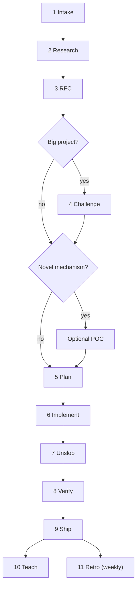

# Guide: how a project moves from ask to shipped

One page per step. Each page explains its purpose and rationale, when to use it, its inputs and outputs, who owns it, which skill and template to use, and when it is done.

This guide explains the workflow in plain words. It does not replace the rules. Guide numbers are for navigation. The [project skill](../skills/start-project/SKILL.md) defines phase numbers and gates. The [architecture standard](../standards/architecture.md) defines code structure and the [guidelines](../GUIDELINES.md#document-status-lifecycle) define document statuses.

## The steps

1. [Intake](./01-intake.md): turn an ask into an agreed problem.
2. [Research](./02-research.md): learn what exists today and pick an approach.
3. [RFC](./03-rfc.md): write the design.
4. [Challenge](./04-challenge.md): try to break a big design before planning. Big projects only.
5. [Plan](./05-plan.md): settle every blocking question and write the code-first plan.
6. [Implement](./06-implement.md): build it, one plan task at a time.
7. [Unslop](./07-unslop.md): clean the diff before any PR.
8. [Verify](./08-verify.md): verify the candidate commit, with evidence an independent checker grades.
9. [Ship](./09-ship.md): open, review, merge and release in a safe order.
10. [Teach](./10-teach.md): offered after every shipped feature, to explain it to the project owner.
11. [Retro](./11-retro.md): optional weekly review of what to improve.

## Optional review and Git tools

- For browser comments on a draft, use [Annotate Doc](../skills/annotate-doc/SKILL.md). Use [Stop Annotate Doc](../skills/stop-annotate-doc/SKILL.md) to close a selected review.
- For dependent GitHub PRs, use [gh-stack](../skills/gh-stack/SKILL.md) where supported. Use [Cleanup Worktrees](../skills/cleanup-worktrees/SKILL.md) after work lands.

## Who is who

**The project owner** is the human responsible for the project. They answer every blocking question, approve each gate, and approve merges, deploys, prod steps, external posts and deletions. Nothing in this guide replaces their decision.

**[Agent personas](../agents/README.md)**
- `general`: the default orchestrator. Takes the ask, writes the project docs, plans with a todo list, routes work to skills and sub-agents, and stops at every decision that belongs to the project owner.
- `librarian`: read-only lookups in code, docs and live systems, one question each, often several in parallel.
- `advisor`: senior design reviewer. Also a challenger on big projects and the independent checker of a verification record, when run outside the author's session.
- `auditor`: critic of written docs, plans and diffs. Also runs the comment pass of `unslop`.
- `executor`: implements one approved plan task at a time.

An agent's approval is never the project owner's.

## Rules that hold at every step

- Read the code and live state before writing about them, and point to the line behind every claim. Why: a plan built on memory or a summary is the most common source of wrong designs.
- No prod read, write or deploy without the project owner's explicit written approval for that exact action. Why: prod mistakes are the expensive ones, and a general approval is easy to stretch.
- Record the project owner's decisions in their exact words. Label the agents' interpretations as such. Why: a paraphrase quietly changes what was agreed.
- An approval relayed by another agent can record a design decision. A merge, deploy, prod step, external post or deletion needs the project owner's own instruction to the acting agent. Why: relays lose context, and these actions cannot be taken back.
- Write PR and deploy status only after a live check. Why: status from memory goes stale within minutes.
- Diagrams are Mermaid. Tables only for comparisons.
