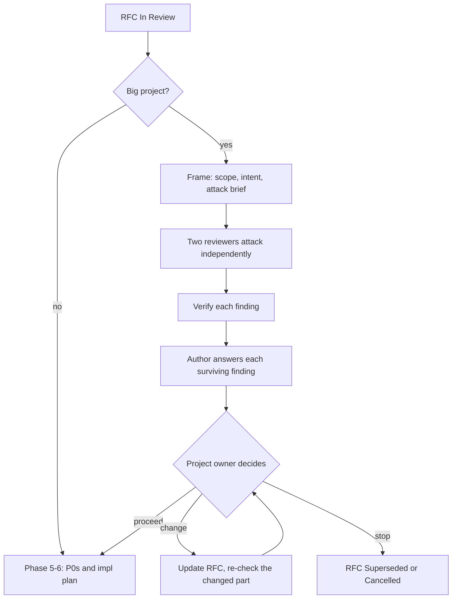

# Challenge

## Overview

A design that will be hard to undo deserves one honest attempt to break it before anyone writes the plan. Challengers who did not write the RFC each try to show it is wrong, too risky, or not needed. The project owner considers the findings that hold up and the author's answers, then decides: proceed, change the RFC, or stop.

This is not the Phase 2 adversarial review. Phase 2 stress-tests the choice between approaches. The challenge attacks the finished design in the RFC, with its data shapes, failure paths and rollout.

## When it applies

Run it when the RFC does any of these:
- adds a new data store, collection, queue, index or service;
- changes behaviour across more than one service or repo;
- is hard to reverse: a data migration, a public contract change, a deletion, or anything that needs a coordinated rollback across teams.

A config fix, a single-service bug fix or a docs change does not need a challenge, unless it is hard to reverse; hard to reverse always qualifies. When in doubt, ask the project owner one short question; do not run it by default, because it takes challengers' time.

Skipping it on a project that meets a trigger is the project owner's call, recorded in their words in the RFC's header notes.

## Roles

- **Author**: the `general` persona (or whoever wrote the RFC). Frames the challenge and answers findings. Does not attack their own design.
- **Challengers**: two independent reviewers outside the author's session, for example the `advisor` persona plus a second senior reviewer. Neither wrote the RFC. Each works alone and does not see the other's output until both have reported. If a second independent reviewer is not available, ask the project owner before going ahead; do not substitute a sub-agent started from the author's session.
- **Verifier**: the author or the `advisor` persona re-checks each finding's evidence.
- **Decider**: the project owner.

## Step 1: Frame

Copy `templates/03-challenge.md` to `<project>/03-challenge.md`. Fill:
- **Scope**: the RFC file and its md5, plus any POC.
- **Intent**: the RFC's goal and success criteria, restated in two or three plain sentences. Every challenger gets the same text.
- **Rubric**: three to six questions the decision turns on, written before anyone attacks. Defaults: Does it meet each success criterion? What fails first under load or bad input? What breaks during a half-finished rollout? How do we undo it? What is the cheapest alternative that gets most of the value? Is it needed at all?

## Step 2: Attack

Give each challenger the scope, the intent, read access to the code, and this brief:

> Break this design. Assume it is wrong and find where. Cover: failure cases (bad input, timeouts, retries, partial failure, duplicates, ordering); scale (the volume in the research doc times ten, and the biggest single item); rollout and rollback (what breaks halfway, how we undo it); cost and ownership; and whether we should build it at all, with the cheapest alternative. Back every finding with evidence: a code line that shows the gap, a number from the research or live data you were allowed to read, a quick prototype or probe, or a concrete input that breaks it. Leave out anything you cannot back: taste, naming, and risks that need a future change to matter. "No findings" is a valid answer. Do not edit the RFC or any code.

Each challenger writes in a separate section or file without seeing the others' output. No prod reads, writes or deploys for the challenge unless the project owner approves that exact action.

## Step 3: Verify

For each finding, re-check its evidence: open the code line, rerun the probe, recompute the number. Keep it if the evidence holds and it breaks the intent or a success criterion. Otherwise, drop it with one line explaining why. Merge findings with the same root cause. Keep every verified finding from every challenger; this is not a vote.

## Step 4: Answer

The author answers each surviving finding with one of:
- **Change**: what will change in the RFC, and where;
- **Accept the risk**: why, and what would make us revisit it;
- **Disagree**: the evidence that the finding is wrong.

Then write a recommendation in the agents' own voice, labelled as their view.

## Step 5: The project owner decides

Send the project owner a short summary: the rubric answers, surviving findings, author's answers and recommendation. Record the decision in the Decision table: `Decided by` (`Owner confirmed` or `Owner chose`), the project owner's decision in their own words, and the date. Only then does Phase 5 start. An approval relayed by another agent can record a design decision; a merge, deploy, prod step, external post or deletion needs the project owner's own instruction to the acting agent.

If they ask for changes, update the RFC (and its Alternatives Considered if an option was rejected), then re-check only the changed part with one challenger.

## Status

The challenge doc uses the normal lifecycle: Draft during the attack, In Review when the answers are written, Approved when the project owner has decided. `lint-docs.py` checks that an Approved, In Progress or Done challenge doc has a Decision table row with `Decided by`, the project owner's decision and the date filled in.

## Red flags

| Thought | Reality |
|---|---|
| "Run it on everything to be safe" | Only big projects. Small changes pay a heavy cost for little. |
| "The challengers can share notes" | Independence is the point. The two challengers each work alone. |
| "This might not scale" | Not a finding without a number or a mechanism. |
| "The advisor approved it, so we can proceed" | An agent's approval is not the project owner's decision. |
| "I'll fix the RFC while reviewing" | Challengers report. The author changes the RFC after the project owner decides. |
