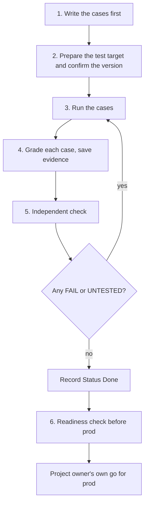

# Verify Feature

## Overview

Verify behavior on an approved test target at the candidate commit. Each case needs evidence an independent checker can open. Use the project’s documented deployment and test procedures. A library or CLI can use a representative local or CI integration environment.

## Why

- Green tests and CI do not run the feature as a user or caller would; a real environment does.
- Evidence for every case, with a second place to read it, prevents reporting untested cases as PASS.
- The new-setting triple (a non-default value, a value at the limit, a save followed by a read-back) catches values that are accepted but never persisted, and settings that only work at their default.
- An independent checker who grades from raw evidence prevents the author from grading their own work.
- The readiness check before prod covers what often causes release incidents: merge order, leftover test data and no way back.

## When it applies

- Every PR that changes behaviour: anything a user, a caller or an operator can see or rely on. This skill calls such a PR a feature PR.
- Docs, formatting and other changes with no effect on behavior can skip this gate. Use project-specific plan or apply evidence for infrastructure changes.
- When unsure, apply it. Skipping it is the project owner's decision, recorded in their words.
- Verification runs against a draft PR or the branch commit, before the PR is marked ready for review. The deploy record names that commit. If the PR head moves after the cases ran, re-run the affected cases: the readiness check needs the verified commit to equal the PR head.

**PRs with no project folder.** A small fix handled without a project folder still follows this skill when it changes behaviour. The cases, expected results and evidence links go in the PR description instead of `06-verification.md`; the checker rule is unchanged; and a test deployment is still required when the change is deployable. The description must also have a "Cases reviewed" line (the cases the checker reviewed) and a "Checked by" line (the checker, named as in `06-verification.md`). Lint cannot see the PR description, so the checker confirms those lines by hand.

## Roles

| Role | Who | Must not |
|---|---|---|
| Author | Whoever wrote the code (usually the `executor` persona) | Grade their own cases as the final word |
| Runner | Usually the author or the orchestrating `general` persona | Edit an assertion to make a case pass |
| Checker | The `advisor` persona (an independent checker outside the author's session) or the project owner. No one else: an `auditor` sub-agent started from the author's own session is not independent | Grade from the runner's grade or summary; accept a case whose evidence they could not open |
| Decider | The project owner | — |

The checker grades every case from the raw evidence. If the checker runs the `auditor` persona to help grade, its usual three-finding cap does not apply: every case gets a grade.

## Step 1: Write the cases before running anything

Copy `templates/06-verification.md` into the project folder as `06-verification.md` and fill the case table first. Take cases from the RFC's success criteria and test plan, with at least one case per criterion.

Each case names:
- what is done (the request, the click, the job run);
- the expected result, stated so it is either met or not;
- the evidence that will prove it, plus a second place to read it: a separate source that shows the same result, not a copy of the first. For example: the response body saved to a file, and the same result read from a database or application log.

**New settings get three cases.** For every new setting, limit, flag or config value:
1. a non-default value, to prove the setting is actually read;
2. a value exactly at the limit, plus one just over it. When the setting has no limit, use the largest value expected in real use and write "no limit" in the case;
3. save the value, then read it back through the normal read path, to prove it is stored and returned.

A plan that only tests the default value is incomplete. Default-only tests are how a broken limit gets past build, review and plan.

**The checker reads the cases before the run.** Before step 2, the checker confirms that every case has a written expected result and named evidence, and flags any that do not. Fix flagged cases before anything runs. Record who reviewed the cases and when in the doc's `Cases reviewed` row.

## Step 2: Confirm the test target

Use the project’s approved non-production environment. For a deployable change, use its deployment procedure, watch the run to completion and confirm the expected revision is running and healthy. For a local or CI integration target, record the setup command, commit and result. Record the environment, candidate commit and evidence in the verification record. If setup fails, record the failure and leave affected cases UNTESTED.

## Step 3: Run the cases

- Use a re-runnable script where possible: the project’s integration harness or a recorded command list. A repeatable check beats a one-time look.
- Derive IDs from live responses; never hardcode them.
- Mutating cases use disposable, clearly named test data. Write the cleanup list before you create anything; it goes in the verification doc.
- Never edit an assertion or a fixture to make a case pass. Fix the code, or grade the case FAIL.

## Step 4: Grade each case and save the evidence

| Grade | Meaning |
|---|---|
| PASS | The expected result happened, and the evidence shows it |
| FAIL | The case ran and the result was wrong. Write what happened |
| UNTESTED | The case did not run, ran on the wrong environment, or its evidence cannot be opened |

Rules:
- Evidence is a file or link a second person can open: a saved response, a log search link, a screenshot, a query result. Save files under the project's `artifacts/verify-<date>/` or in an approved evidence store. Record the link and revision or checksum when useful.
- Open each evidence link yourself before you grade. A link that returns 404, or a file the checker cannot access, is UNTESTED, never a soft pass.
- "Inconclusive" is UNTESTED. A partial pass is FAIL with a note.
- Mask secrets, tokens and customer data before saving evidence files.

## Step 5: Independent check

Give the checker the verification doc and access to the raw evidence. The checker grades every case from that evidence (job output, results file, test record IDs, log lines, saved responses), not from the runner's grade or summary. The checker:
1. opens every evidence item and compares it with the case's written expected result;
2. writes a grade for every case in the `Checker grade` column. A partial result is never PASS;
3. confirms the three setting cases exist for every new setting;
4. confirms the deploy record's commit matches the PR head commit;
5. writes their name and the time in the doc's `Checked by` row.

The checker's grade wins. Any FAIL or UNTESTED sends the work back to step 3 and remains open on the project's index row until it is re-run.

## Step 6: Readiness check before prod

Before any prod step (merge that auto-deploys, prod deploy, prod config change), the checker fills the readiness section of the verification doc:

- [ ] Every case PASS in the checker's column, graded from raw evidence by the `advisor` persona or the project owner.
- [ ] The verified commit equals the PR head now; otherwise re-run the affected cases first.
- [ ] The PR's state was read live from the forge just now, and the doc quotes that read with the time. No status is written from memory.
- [ ] Dependent PRs are listed in merge order, with the reason. Example: a fix PR merges with or before the PR whose behaviour depends on it.
- [ ] The test-data cleanup list is written and agreed with the project owner. Deleting anything still needs their go.
- [ ] Rollback is written: the exact revert or redeploy step.
- [ ] What will be watched after release, by whom (usually whoever is on call for the service).
- [ ] The project owner's go for the prod step, recorded in their exact words with the date. An agent's approval is not the project owner's. An approval relayed by another agent can record a design decision; a merge, deploy, prod step, external post or deletion needs the project owner's own instruction to the acting agent.

## Reporting

Report to the requester in this order: the PR and head commit; the test target and setup result; a count of PASS, FAIL and UNTESTED; each FAIL and UNTESTED with its reason; who checked and when; the readiness items still open. Say "verified" only when every case is PASS and checked.

## Red flags

| Thought | Reality |
|---|---|
| "CI is green, so it works" | CI does not run the feature as a user would. Run the cases. |
| "The evidence link was fine yesterday" | Open it now. A link you did not open is UNTESTED. |
| "Only the default matters for now" | New settings need non-default, at-limit and save-then-read-back cases. |
| "I wrote it, I know it passes" | The author's grade is not the final grade. |
| "The runner's summary says PASS" | The checker grades from the raw evidence, and partial is never PASS. |
| "Probably merged by now" | Read the PR live before writing its status. |
| "The project owner said ok earlier" | Record their exact words, or ask. |
| "I'll clean up the test data later" | Write the cleanup list before creating test data. |
