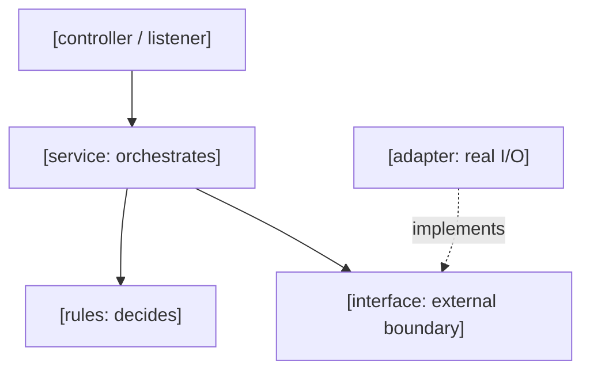
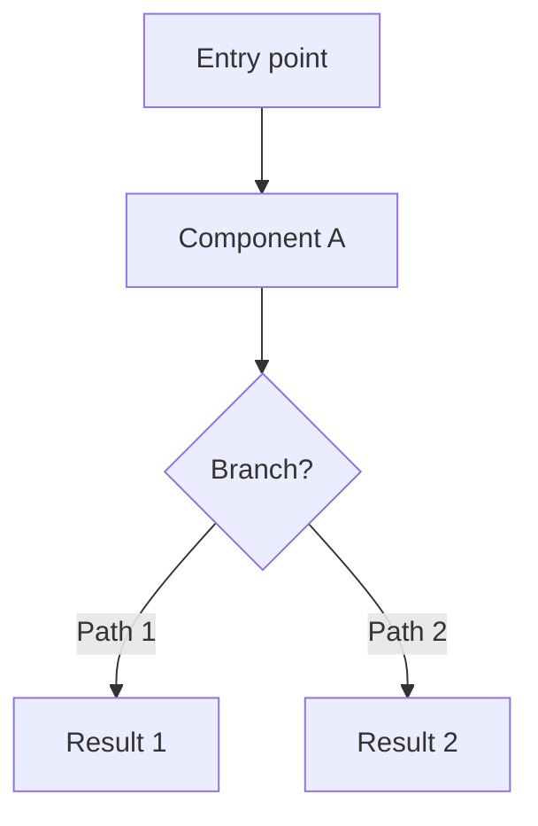

# RFC: [Feature Name]

<!-- Status values: Draft | In Review | Approved | In Progress | Done | Superseded | Deferred | Cancelled — GUIDELINES.md § Document Status Lifecycle -->
| Field | Value |
|---|---|
| **PIC(s)** | [Your name] |
| **Contributors** | — |
| **Created** | YYYY-MM-DD |
| **Status** | Draft |
| **Outcome** | [Fill after implementation: one sentence on final state] |
| **Related Docs** | [Research doc](./01-research.md) · [Impl Plan](./05-impl-plan.md) · [PR Plan](./07-pr-plan.md) |

---

## Business Value

> One or two sentences, or a tight list. What breaks or costs more if this doesn't ship? Be concrete — avoid "improves maintainability."
>
> Good: "Adding a new component type currently touches 3 files. After this, it touches 1 — extensions need one documented registration step."
> Bad: "This will make the code cleaner."

---

## Context

### Module and service involved

- **Service**: [service name and module]
- **Entry flow**: [Class A] → [Class B] → [Class C] — the path a request takes to the relevant code

### Current mechanism

> Describe how it works TODAY. Read the code first — write this only after reading. Write it as a causal narrative, not a list of facts: walk through the path, explain what each layer does, and surface the specific interaction that produces the problem. This section is the foundation that makes the Solution Design section comprehensible.
>
> Name the method, the class, and the line. If there's a subtle interaction between two layers (e.g., a null from a convenience getter is ambiguous because it absorbs two distinct states), explain it here.

### Constraints

| Constraint | Why |
|---|---|
| [Constraint] | [Reason — trace to file/line or team decision] |

---

## Problem Statement

> Number each problem. Each should describe a mechanism that produces a bad outcome — not a symptom, not a wish. A reader should be able to verify the problem by reading the referenced code.
>
> Format: [what the code does] → [why that produces the bad outcome].

1. **[Problem name]**: [Description with file/method reference]

2. **[Problem name]**: [Description with file/method reference]

---

## Success Criteria

> Each criterion must be verifiable — either it is met or it isn't. No "improved" or "better." Each criterion should trace to a numbered problem above.

- [Binary criterion]. (Solves Problem 1)
- [Binary criterion]. (Solves Problem 2)
- All existing [tests] pass without modification. (Non-regression)

---

## Scope

### In-scope

1. [Concrete deliverable with file/class names]
2. [Concrete deliverable]

### Out-of-scope

- [Related problem explicitly deferred] — deferred because [reason]
- [Adjacent concern] — different problem, not blocking

---

## Solution Design

### Overview

> One paragraph. Lead with the non-obvious insight: *what did you learn about the code that makes this specific solution the right one?* Not "we updated X to do Y" — but "the only place that distinguishes A from B is Z, so the fix goes there."
>
> A reader who understands this paragraph should find the steps below predictable. If the steps feel surprising, the insight is missing from this paragraph.

### Step 1 — [First design decision]

> Explain the mechanism. Lead with *why* before *how*. Show before/after code where the comparison adds something prose cannot.

```text
// Before
[code]

// After
[code]
```

### Step 2 — [Second design decision]

[Same pattern]

### Structure and boundaries

> Follows the research doc's `Structure conventions` unless a P0 says otherwise (rules: `standards/architecture.md`). A Mermaid component diagram, arrows pointing in the direction of dependency: new units against the existing ones they touch. Mark each boundary that gets an interface (external I/O, stubs, 2+ implementations).



| Unit | Package | Responsibility (one sentence) |
|---|---|---|
| [name] | [package] | [what it does] |

### Adding a new [thing] (end-to-end)

> The "how do I extend this?" walkthrough. Should be short. If it's long, the design is too complex.

1. [Step 1]
2. [Step 2 — or "Done. No other files change."]

---

### Special Cases

> Things that cannot follow the generic path. Name each, explain why it is special, and describe how it is handled. Use a table only if there are 3+ cases with parallel structure; otherwise write it as prose.

| Case | Why generic doesn't work | Handling |
|---|---|---|
| `SOME_TYPE` | [reason] | [how handled] |

---

### Flow Diagram

> Use Mermaid. Choose the right type (see GUIDELINES.md § Diagrams). Only include if the diagram shows something the prose and code do not already make clear.



---

## Error Handling

> Include only if failure modes are non-trivial — i.e., a reader could not predict error behavior from reading the Solution Design. If failures are straightforward (e.g., "validation error returns existing error type"), skip this section.

| Failure condition | Current behavior | Proposed behavior |
|---|---|---|
| [Failure] | [What happens now] | [What happens after] |

---

## Test Plan

### Unit tests

- **[Case]**: [What input, what expected output, what assertion]
- **[Edge case]**: [What edge case, what expected behavior]
- **[Error path]**: [What failure condition, what expected behavior]

### Regression tests

- Run existing `TestClassName` — all tests must pass without modification

---

## Alternatives Considered

> **Phase exit condition**: Every rejected approach must have a rejection category and a specific reason for rejection. "It was simpler" is not a reason — trace the rejection to a code constraint, a team decision, or an explicit tradeoff.
>
> Rejection categories: `TECHNICAL_INFEASIBLE` · `BREAKS_EXISTING_CONSTRAINT` · `COST_TOO_HIGH` · `DEFERRED` · `SUPERSEDED`

### 1. [Alternative name]

**Rejection category**: [category]

**Revisit condition**: [When this becomes viable, or "Not worth revisiting — [reason]"]

[One paragraph. Why it was appealing, why it was rejected. Be specific.]

---

## Unresolved Questions

> Questions that need answers before or during implementation.

- [ ] **[Question]**: [Why it matters] — options: [A], [B], [C]
- [x] **[Resolved question]**: [Decision made and why]

---

## Known Limitations

> Explicit list of what this solution intentionally does not solve. Prevents reviewers from expecting things that were out of scope.

### [Limitation name]

[What it is, why it's out of scope, path to full resolution if one exists.]

---

## Future Work

- **[Follow-up item]**: [What it is and when it should be done]

---

## Implementation Learnings

> Fill in AFTER implementation. One entry per design pivot that differed from this RFC. A future engineer reading this should understand what changed and why — not just what the final state is.

### 1. [Title]

**Original plan**: [What the RFC said]

**What actually happened**: [What changed during implementation]

**Why**: [What you discovered that the plan didn't anticipate]

---

## References

- [Research doc](./01-research.md)
- `FileName.[ext]` — L[start]–L[end]: [what's there]
