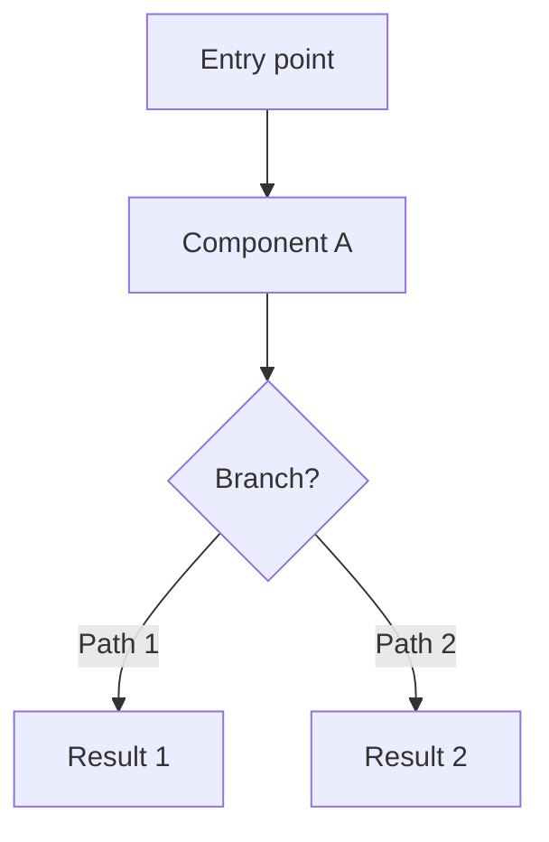

# RFC: [Feature Name]

| Field | Value |
|---|---|
| **PIC(s)** | [Your name] |
| **Contributors** | — |
| **Created** | YYYY-MM-DD |
| **Status** | Draft \| Under Review \| Approved \| ✅ Implemented |
| **Session PWD** | [Working directory where this opencode session was opened — fill from env on session start] |
| **Outcome** | [Fill in after implementation: what the final state is in one sentence] |
| **Related Docs** | [Research doc](./01-research.md) · [Impl Plan](./03-impl-plan.md) · [PR Plan](./05-pr-plan.md) |

---

## Business Value

> Why does this matter? Be concrete and measurable. Avoid generic claims like "improves maintainability."
>
> Good: "Adding a new handler type drops from 3 file changes to 1 new class. Reduces time-to-ship for new feature types."
> Bad: "This will make the code cleaner."

- **[Value dimension]**: [Specific measurable impact]
- **[Value dimension]**: [Specific measurable impact]

---

## Context

### Module and service involved

- **Service**: [service name and module]
- **Entry flow**: [Class A] → [Class B] → [Class C] — the path a request takes to the relevant code

### Current mechanism

> Describe how it works TODAY. Read the code first — write this only after reading. Write it as a causal narrative, not a list of facts: walk through the path, explain what each layer does, and surface the specific interaction that produces the problem. This section is the foundation that makes the Solution Design section comprehensible.
>
> Name the method, the class, and the line. If there's a subtle interaction between two layers (e.g., a null from a convenience getter is ambiguous because it absorbs two distinct states), explain it here.

`ClassName.methodName()` does [X]. It contains [N] cases on [Y]. Each case:
1. [Step 1]
2. [Step 2]

### Constraints

> What cannot change. Generated code, external contracts, team ownership, deployment constraints.

| Constraint | Why |
|---|---|
| [Constraint 1] | [Reason] |
| [Constraint 2] | [Reason] |

---

## Problem Statement

> Number each problem. Be specific. Each problem should trace directly to a concrete pain in the codebase — not a theoretical concern.

1. **[Problem name]**: [Specific description with file/method references]

2. **[Problem name]**: [Specific description with file/method references]

3. **[Problem name]**: [Specific description with file/method references]

---

## Success Criteria

> Each criterion must be binary — either it is met or it isn't. No "improved" or "better." Reference the specific problem each criterion solves.

- Adding a new [thing] requires only [N steps]. No existing files are modified. (Solves Problem 1)
- [Criterion]. (Solves Problem 2)
- All existing [things] continue to produce identical output. (Verified by tests)

---

## Scope

### In-scope

1. [Concrete deliverable with file/class names]
2. [Concrete deliverable]

### Out-of-scope

- [Related problem explicitly deferred] — deferred to [reason/follow-up]
- [Adjacent concern] — different concern, not blocking

---

## Functional Requirements

| ID | Requirement | Description |
|---|---|---|
| FR-1 | [Short name] | [What the system must do] |
| FR-2 | [Short name] | [What the system must do] |

---

## Technical Requirements

| ID | Aspect | Requirement |
|---|---|---|
| TR-1 | [Aspect] | [Constraint on how it must be implemented] |
| TR-2 | [Aspect] | [Constraint] |

---

## Solution Design

### Overview

> One paragraph. Lead with the non-obvious insight: *what did you learn about the code that makes this specific solution the right one?* Not "we updated X to do Y" — but "the only place that distinguishes A from B is Z, so the fix goes there."
>
> A reader who understands this paragraph should find the steps below predictable. If the steps feel surprising, the insight is missing from this paragraph.

### What gets eliminated

> List specifically what goes away. This makes the review scope concrete for the team.

- `FileToDelete.java` — deleted entirely
- `someMethod()` — removed from `ClassName`

### What gets added

> List new files/classes with a one-line description of each.

- `NewClass.java` — [what it does]
- `AnotherClass.java` — [what it does]

### Architectural Components

| Component | Type | Role |
|---|---|---|
| `ClassName` | New `@Component` / Existing / Modified | [What it does] |

---

### Step 1 — [First design decision]

> Explain the mechanism. Include concrete code showing the before and after where it helps.

```java
// Before
[code]

// After
[code]
```

---

### Step 2 — [Second design decision]

[Same pattern]

---

### Adding a new [thing] (end-to-end)

> The "how do I extend this?" walkthrough. Should be short. If it's long, the design is too complex.

1. [Step 1]
2. [Step 2 — or "Done. No other files change."]

---

### Special Cases

> Things that cannot follow the generic path. Name each explicitly, explain why, and describe how they're handled.

| Type | Special behavior | Handling |
|---|---|---|
| `SOME_CASE` | [Why generic doesn't work] | [How it's handled] |

---

### Flow Diagram

> Use Mermaid. Never ASCII art. See GUIDELINES.md § Diagrams for type selection.



---

## Error Handling

| Failure condition | Current behavior | Proposed behavior |
|---|---|---|
| [Failure] | [What happens now] | [What happens after] |

---

## Test Plan

### Unit tests

- **Happy path**: [What input, what output, what assertion]
- **Edge case**: [What edge case, what expected behavior]
- **Error path**: [What failure condition, what expected behavior]

### Regression tests

- Run existing `TestClassName` — all tests must pass without modification

---

## Alternatives Considered

> **Phase exit condition**: Every rejected approach must have a rejection category. Empty or vague entries here are not acceptable.
>
> Rejection categories: `TECHNICAL_INFEASIBLE` · `BREAKS_EXISTING_CONSTRAINT` · `COST_TOO_HIGH` · `DEFERRED` · `SUPERSEDED`

### 1. [Alternative name]

**Rejection category**: `TECHNICAL_INFEASIBLE` | `BREAKS_EXISTING_CONSTRAINT` | `COST_TOO_HIGH` | `DEFERRED` | `SUPERSEDED`

**Revisit condition**: [Condition under which this is worth re-evaluating, or "Not worth revisiting — [reason]"]

[Description]

- **Pros**: [Why it's appealing]
- **Cons**: [Specific reason it was rejected — trace to a constraint or codebase fact]

---

## Unresolved Questions

> Questions that need answers before or during implementation. Mark as resolved when answered.

- [ ] **[Question]**: [Why it matters] — options: [A], [B], [C]
- [x] **[Resolved question]**: [Decision made and why]

---

## Known Limitations

> Things the solution intentionally does NOT solve. Be explicit so reviewers don't expect them.

### [Limitation name]

[What it is and why it's out of scope. Include a path to full resolution if it exists.]

---

## Future Work

- **[Follow-up item]**: [What it is and when it should be done]

---

## Next Steps

| # | Action | Status |
|---|---|---|
| 1 | Resolve unresolved questions | ⏳ |
| 2 | Review and approve RFC | ⏳ |
| 3 | [Implementation task] | ⏳ |

---

## Implementation Learnings

> Fill in AFTER implementation. Document every design pivot that differed from this RFC. Future engineers reading this should understand what changed and why.

### 1. [Learning title]

**Original plan**: [What the RFC said]

**What actually happened**: [What changed during implementation]

**Benefit / reason**: [Why the pivot was made]

---

## References

- [Research doc](./01-research.md)
- `FileName.java` — L[start]–L[end]: [what's there]
