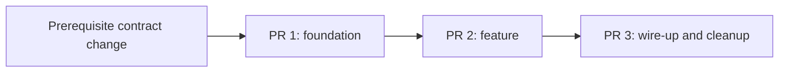

# PR Plan: [Feature Name]

<!-- Status values: Draft | In Review | Approved | In Progress | Done | Superseded | Deferred | Cancelled — GUIDELINES.md § Document Status Lifecycle -->
| Field | Value |
|---|---|
| **RFC** | [RFC](./02-rfc.md) |
| **Impl Plan** | [Impl Plan](./05-impl-plan.md) |
| **Created** | YYYY-MM-DD |
| **Status** | Draft |

---

## Why [N] PRs

> Explain the split rationale. The goal: each PR must be independently reviewable (reviewers can evaluate correctness without understanding the whole change) and independently revertable (if one PR regresses, it can be reverted without taking down the whole feature).

| PR | What it contains | What it does NOT touch | Reviewers must evaluate |
|---|---|---|---|
| PR 1 | [What] | [What not] | [The single question a reviewer answers] |
| PR 2 | [What] | [What not] | [The single question] |
| PR 3 | [What] | [What not] | [The single question] |

> **Rule of thumb for PR splitting**:
> - Schema/contract changes come first — they're safe to ship early and unblock everything else
> - New code without wire-up comes next — purely additive, easy to review in isolation
> - Wire-up + deletion comes last — changes behavior; tests are the gate

---

## PR 1 — [Name]

**Branch**: `[branch-name]`

**Impl plan tasks**: [Phase X, Task Y.Z]

### Summary

[One paragraph: what this PR does and why it has zero/minimal production behavior change.]

### Files Changed

| File | Change |
|---|---|
| `path/to/file` | [What changed] |

### Test Plan

```text
# Command to run
[project test command]
# Expected: [N]/[N] pass
```

### PR Description Template

```
## Summary

[What this PR does in 2-3 sentences. Link to the RFC.]

This is PR [N] of [total] for [feature name]. See [RFC link] for full context.

**[Production behavior change statement]** — e.g. "No production behavior change in this PR."

## Overall Plan

- **PR 1 (this PR)** — [What]
- **PR 2** — [What]
- **PR 3** — [What]

## Test Plan

1. `[project test command]` → all tests pass
2. [Manual verification step if needed]

## Subscribers

@[team-channel]
```

---

## PR 2 — [Name]

**Branch**: new branch off PR 1's merge commit, e.g. `[branch-name]`

**Impl plan tasks**: [Phase X, Tasks Y.Z–Y.W]

### Summary

[What this PR introduces. State explicitly what it does NOT touch — this is the key sentence for reviewers.]

### Files Changed

| File | Change |
|---|---|
| `path/to/NewFile.[ext]` | New — [what it does] |
| `path/to/ModifiedFile.[ext]` | Modified — [what changed] |

### Test Plan

```text
[project test command]
# → all tests pass ([existing tests] untouched — [old mechanism] still in place)
```

### PR Description Template

```
## Summary

[What this PR does. What it does NOT change — e.g. "[ExistingClass] is not modified in this PR."]

This is PR 2 of [total]. See PR 1 for [foundation]. PR 3 wires everything together.

**New classes:**
- `ClassName` — [what it does]
- `ClassName` — [what it does]

## Overall Plan

- **PR 1** — [What] ✅ merged
- **PR 2 (this PR)** — [What], [ExistingClass] untouched
- **PR 3** — Wire-up + deletion

## Test Plan

1. `[project test command]` → all tests pass
2. [Specific check — e.g. "Each new class has a unit test covering happy path + error cases"]

## Subscribers

@[team-channel]
```

---

## PR 3 — Wire-up + Cleanup

**Branch**: new branch off PR 2's merge commit, e.g. `[branch-name]`

**Impl plan tasks**: Final phase (wire-up + deletion + integration verification)

### Summary

The payoff PR. Injects [NewComponent] into [ExistingClass], replaces [old mechanism] with [new mechanism], and deletes all dead code. Mostly deletions. The interesting logic was already reviewed in PR 2.

### Files Changed

| File | Change |
|---|---|
| `path/to/ExistingClass.[ext]` | Inject [NewComponent]; replace [old mechanism]; delete [N] methods ([~X lines]) |
| `path/to/DeadFile.[ext]` | **Deleted** entirely |
| `src/test/.../TestExistingClass.[ext]` | Update test wiring; all assertions unchanged — regression gate |

### Test Plan

```text
# Regression gate
[project test command]
# → [TestExistingClass] all pass

# Manual smoke test
[project smoke-test command]
# [Describe: what endpoint to hit, what payload to use, what to compare against]
```

### PR Description Template

```
## Summary

Wires [NewComponent] (introduced in PR 2) into [ExistingClass] and removes all code it replaces.
[The old mechanism] is replaced with [N lines describing the new mechanism]. All [old methods/files]
are deleted.

This is PR 3 of [total]. The framework was introduced and reviewed in PR 2 — this PR is
intentionally narrow: inject, replace, delete. No new logic added.

**Net deletion**: ~[X] lines removed, ~[Y] lines added.

## Overall Plan

- **PR 1** — [What] ✅ merged
- **PR 2** — [What] ✅ merged
- **PR 3 (this PR)** — Wire-up + deletion

## How to extend going forward

1. [Step 1 — e.g. add schema annotation]
2. [Step 2 — e.g. run codegen]
3. Done — [what does NOT need to change]

## Test Plan

1. `[project test command]` → all tests pass, including [TestExistingClass]
2. Manual smoke: [what to verify]

## Subscribers

@[team-channel]
```

---

## Summary Timeline


