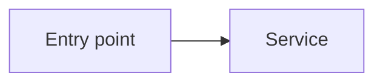

# Teach: [Feature Name]

| Field | Value |
|---|---|
| **For** | [project owner] |
| **Shipped in** | [PR links, merge commits] |
| **Written** | YYYY-MM-DD |
| **Sources** | [01-research.md](./01-research.md) · [02-rfc.md](./02-rfc.md) · [06-verification.md](./06-verification.md) |

---

## The problem

[One paragraph, no code: what was broken or missing and who it hurt.]

## What we chose and why

- **[Option A, chosen]**: [one line]. Chosen because [reason]. Decided by [who, quoted if the project owner decided].
- **[Option B]**: [one line]. Not chosen because [reason].
- **[Option C]**: [one line]. Not chosen because [reason].

## How it works

[One sentence naming the thing in general terms.]

[Follow one real request or job through the main files in order, one line per file.]

1. `path/to/EntryPoint.[ext]`: [what happens at this step]
2. `path/to/Service.[ext]`: [...]
3. `path/to/Client.[ext]`: [...]

[Add a second, slightly larger diagram only if a third moving part needs it.]

## Traps

- **[Trap]**: [what goes wrong, and when]. Lives in `path/to/File.[ext]`.
- **[Trap]**: [...]

## Quiz

1. What would break if [...]?
2. Why did we not use [Option B]?
3. Where would you change [...] to [...]?
4. [...]

Answers

1. [Answer, with the source doc or file]
2. [...]

