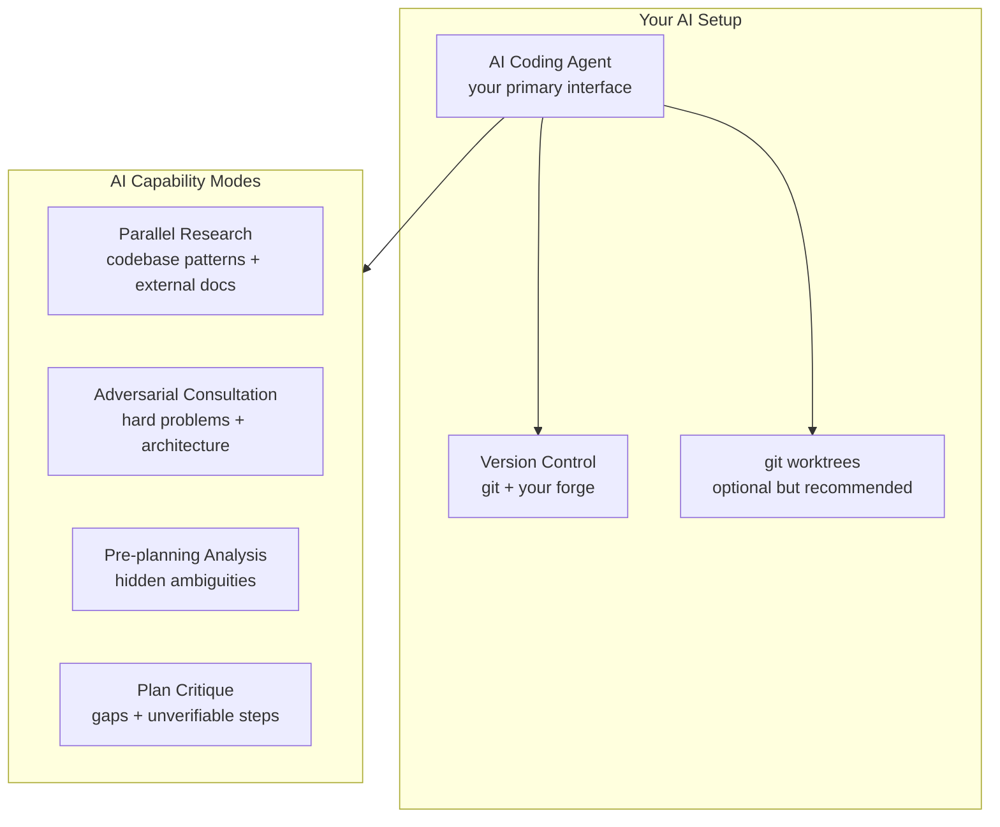
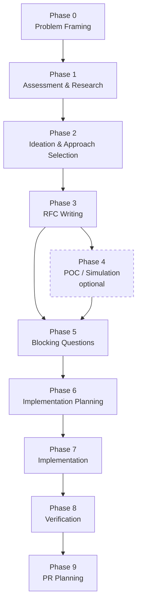
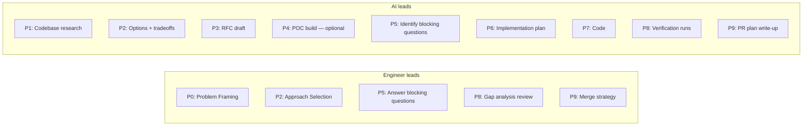
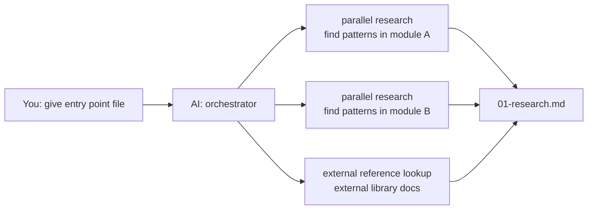
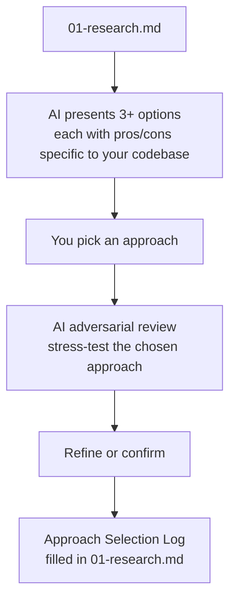
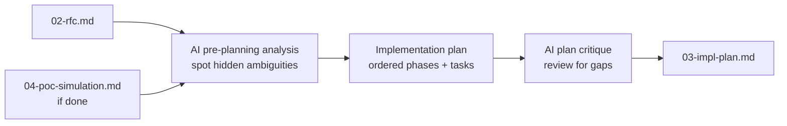
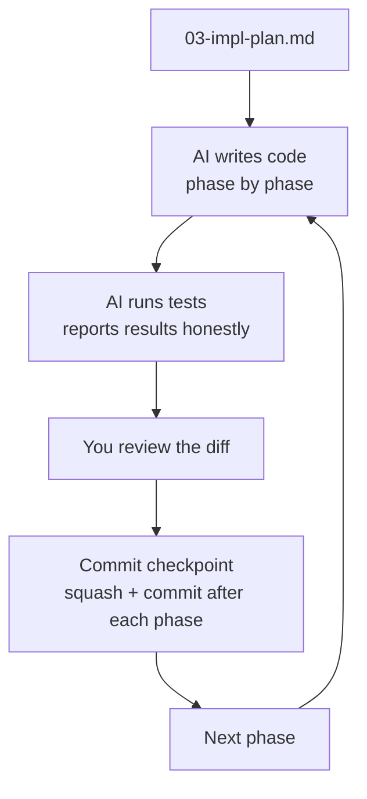
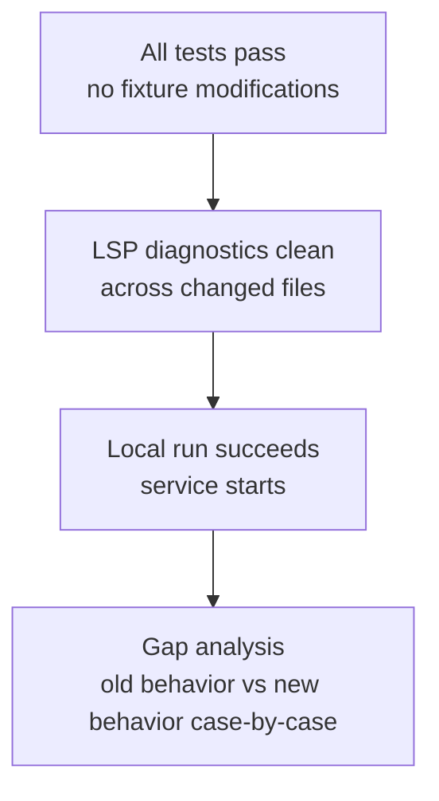
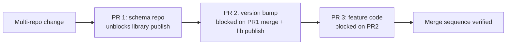
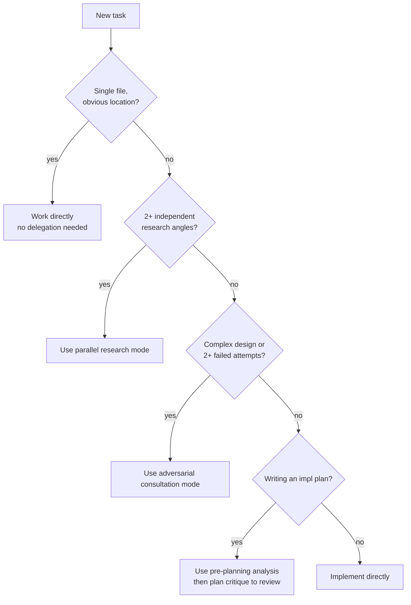

# AI–Engineer Collaboration Workflow
**A practical guide for working with AI coding assistants on non-trivial engineering tasks**

| Field | Value |
|---|---|
| **Created** | 2026-05-12 |
| **Status** | Living document — update as new patterns are discovered |

---

## Why This Document Exists

Working with an AI assistant on a non-trivial feature is fundamentally different from using it as a code autocomplete tool. When done well, the collaboration covers the full engineering lifecycle — assessment, research, architecture, adversarial review, implementation, verification — at a pace and depth that a single engineer working alone cannot match.

This document captures the workflow, handoff patterns, and practices that make this repeatable.

---

## The Collaboration Model

Think of the AI as a **senior engineer pair**:
- It does not own the decision. You do.
- It can go wide (parallel research, exhaustive search) faster than any human.
- It makes mistakes — especially on assumptions, schema interpretation, and "obvious" behavior. Your job is to catch those.
- The best output comes from tight feedback loops, not long autonomous runs.

> **One rule above all others**: Correctness over done. An AI that adjusts a test fixture to make a test pass is not helping you — it is hiding a bug. Call it out.

---

## The Core Epistemic Risk

AI confidence is a style signal, not a correctness signal. The model writes with consistent fluency whether it is right or hallucinating. There is no tonal difference between a correct architectural recommendation and a plausible-sounding one that will fail under load.

This has one direct implication: **you cannot use output confidence to estimate output correctness**. Your own domain knowledge is the only calibration tool you have. Where that knowledge is thin, your risk exposure is highest — not lowest, which is the intuitive assumption.

The second risk is **sycophancy**: the model is structurally biased toward confirmation because agreeable responses scored higher during training. It will avoid contradicting confident-sounding premises even in technical domains. This means your framing shapes what the AI proposes more than you might realize. State constraints explicitly; don't assume the AI will push back on a flawed premise.

---

## AI Tooling Concepts

The workflow relies on several AI capability modes. The specific tool providing each capability depends on your AI assistant.

| Capability | What it does | When to use |
|---|---|---|
| **Parallel research** | Explore codebase patterns across multiple modules simultaneously | Unfamiliar module, cross-layer search |
| **External reference lookup** | Search external docs, library APIs, OSS examples | Unfamiliar dependency, weird library behavior |
| **Adversarial consultation** | High-quality reasoning for architecture, hard debugging, complex tradeoffs | After 2+ failed attempts, complex design decisions |
| **Pre-planning analysis** | Find hidden ambiguities and landmines before you start | Complex or ambiguous requests |
| **Plan critique** | Evaluate implementation plans for gaps, unverifiable steps, missing context | Before committing to an implementation plan |

> **If you're using OpenCode + OhMyOpenCode**: these capabilities map directly to named subagent types — `explore` (parallel research), `librarian` (external reference lookup), `oracle` (adversarial consultation), `metis` (pre-planning analysis), `momus` (plan critique). Workflow instructions can be loaded by name with the `skill` tool.

---

## Workflow Overview

> P4 (POC) is optional — do it when the approach is novel enough that you need to prove it works *before* locking the implementation plan. If the approach is well-understood, skip straight to P5.

---

## Who Does What Per Phase

---

## Phase-by-Phase Guide

### Phase 0 — Problem Framing

**Who leads**: Engineer
**AI role**: Listener and clarifier

Before touching any tool, spend 5–10 minutes describing the problem to the AI in plain language. The AI's first job is to make sure it understood correctly. Watch for:

- It rephrasing the problem in a way that subtly shifts scope
- Assuming the problem statement implies a specific solution
- Missing constraints you stated verbally but not in writing

**Before reading the AI's restatement, write your own problem statement first.** Even one sentence. This forces you to engage your own model before being exposed to the AI's framing, so you are comparing rather than absorbing.

**A good problem statement is a causal chain.** Name the specific code path, explain what it does wrong, trace that to the consequence. A reader should be able to verify or refute the problem by reading the referenced code.

Wrong: "The current code doesn't handle some edge cases."
Right: "`validateIDNumber(null, null)` returns `true` unconditionally when `regexName` is null. A product that configures the ID field as required but with no regex can receive a booking with a blank passenger ID."

**Artifact produced**: A clear, agreed problem statement → `projects/<name>/01-research.md`

---

### Phase 1 — Assessment / Research

**Who leads**: AI (with engineer directing scope)
**AI role**: Codebase explorer + pattern extractor

The AI reads the relevant code, maps the current structure, and produces a research document. It should answer:

1. What does the code actually do today?
2. What patterns already exist that could be extended?
3. What are the pain points, with concrete examples?
4. What constraints exist that a naive solution would violate?

**Anti-patterns to watch for**:
- AI gives you an answer before reading the code
- Research doc has no actual code references (file + line)
- AI ignores existing patterns and proposes something entirely new

**Context window risk**: Critical constraints identified here must be captured as explicit structured fields in `01-research.md`, not buried in prose paragraphs. Prose can be silently dropped during context compaction in later sessions; structured fields survive.

---

### Phase 2 — Ideation and Approach Selection

**Who leads**: Engineer (with AI presenting options)
**AI role**: Options presenter + adversarial reviewer

**Key practice — adversarial review**: Before finalizing the approach, explicitly ask:
> "Please use a different hat and stress-test this approach. What could go wrong? What have we missed?"

**Key practice — ask for what was not mentioned**: After receiving options, explicitly ask:
> "What approaches are you not recommending here, and why?"

**Phase exit condition — Approach Selection Log must be complete before proceeding to Phase 3.**

The `## Approach Selection Log` section in `01-research.md` must be filled with:
- Which options were on the table
- Which were eliminated and why (with rejection category)
- Which was chosen and by whom (`AI proposed` / `[OWNER] confirmed` / `[OWNER] chose`)
- What conditions would make a rejected approach worth revisiting

---

### Phase 3 — RFC Writing

**Who leads**: AI (drafting), Engineer (reviewing)
**AI role**: RFC author

RFC covers: business value · context · problem statement · success criteria · solution design · alternatives considered · error handling · unresolved questions.

**How to review**:
- Every design decision should trace back to a problem or constraint
- "Alternatives considered" must honestly reflect why options were rejected
- "Improved maintainability" is not a success criterion — make it measurable

**RFC as an AI hallucination guardrail**: Team RFC review is not just engineering process — it is an external validation layer that compensates for silent AI failures. The RFC must surface assumptions explicitly — not just the conclusions, but the reasoning behind them.

**Artifact produced**: `projects/<name>/02-rfc.md`

---

### Phase 4 — POC / Simulation *(optional)*

**When to do this**: When the chosen approach is novel enough that you need to prove it works *before* writing the implementation plan.

**AI role**: Builds a minimal working proof — not production code.

The POC answers one question: "Does this technical approach actually work?" It can skip error handling, tests, and edge cases.

**Artifact produced** *(if done)*: `projects/<name>/04-poc-simulation.md`

---

### Phase 5 — Pre-conditions and Blocking Questions

**Who leads**: AI (identifying), Engineer (resolving)
**AI role**: Risk enumerator

Before writing any code, the AI explicitly lists every question that must be answered first.

**P0 format** — each blocking question requires a `Decided by` and `Reasoning` column:

| # | Question | Why it blocks | Options | Decision | Decided by | Reasoning |
|---|---|---|---|---|---|---|
| P0-1 | ... | ... | A / B | ✅ A | `[OWNER] confirmed` | [one sentence] |

`Decided by` must be `[OWNER] confirmed` or `[OWNER] chose` before implementation starts. An AI-proposed resolution without your explicit sign-off does not unblock Phase 6.

---

### Phase 6 — Implementation Planning

**Who leads**: AI (drafting), Engineer (reviewing)
**AI role**: Task decomposer

Each task in the plan has:
- What to do
- Which files change
- Definition of done (verifiable, not "looks good")
- Dependencies on other tasks

**Key practice — phase ordering**: Schema/contract changes first. Dead code deletion last.

**Reviewing against your criteria, not the plan's**:

| Question | Why it matters |
|---|---|
| What is the rollback strategy? | Mid-deployment failures are common. No rollback path = incomplete plan. |
| What breaks if this deploys halfway? | Partial deployment is the default failure mode. |
| What are the observability hooks? | If you cannot see what this is doing in production, you cannot operate it. |
| Where are the implicit assumptions about system state? | AI plans frequently assume clean state that does not exist in production. |
| What does this look like under 10x load? | Many plans correct at current scale are not correct at scale. |
| Is retry behavior defined for every external call? | Especially relevant for Kafka consumers and downstream HTTP calls. |

---

### Phase 7 — Implementation

**Who leads**: AI (writing code), Engineer (reviewing and directing)
**AI role**: Code author

**Critical practices**:

- **Commit frequently** — after each phase passes tests, commit. Don't let 10 phases of changes accumulate.
- **Test correctness, not just passage** — if the AI says "153 tests pass," ask: "Did you change any fixtures or assertions?"
- **Don't let the AI clean up adjacent code** — a bug fix should be minimal. Refactoring while fixing = noise + risk.
- **Read generated diffs on complex logic** — plausible-looking code can have subtle mistakes.
- **Two-worktree pattern** — keep main and feature branch checked out simultaneously. Before/after comparison becomes trivial.
- **Log design pivots immediately** — when the implementation diverges from the RFC, stop. Fill `## Design Pivots` in `03-impl-plan.md` before continuing.

---

### Phase 8 — Verification

**Who leads**: Both
**AI role**: Verifier

The **gap analysis pattern** for refactors:
- Use parallel research to extract all old cases + exact behavior, and all new implementations simultaneously
- Synthesize side-by-side
- This is the only reliable way to catch subtle regressions that tests don't cover

---

### Phase 9 — PR Planning and Sequencing

**Who leads**: Engineer (decides strategy), AI (writes the plan)
**AI role**: PR sequence planner

The PR plan covers:
- Which PRs in which order
- Which are blocked by external dependencies (library publish, upstream merge)
- What to verify between each merge

**Artifact produced**: `projects/<name>/05-pr-plan.md`

---

## Decision Preservation — Phase Exit Conditions

| Phase | Exit condition — doc must be complete |
|---|---|
| 2 — Approach selection | `## Approach Selection Log` in `01-research.md`: options, eliminations with rejection category, chosen approach, decided by |
| 3 — RFC | `## Alternatives Considered` in `02-rfc.md`: every rejected approach has a rejection category and revisit condition |
| 5 — P0 resolution | P0 table in `03-impl-plan.md`: every row has Decision, Decided by, and Reasoning |
| 7 — Implementation | `## Design Pivots` in `03-impl-plan.md` up to date; significant pivots also in RFC `## Implementation Learnings` |

**An AI agent must not proceed to the next phase until the exit condition for the current phase is met.**

### Rejection Category Reference

| Category | Meaning | Revisitable? |
|---|---|---|
| `TECHNICAL_INFEASIBLE` | Can't be done given current stack or constraints | Only if constraints change |
| `BREAKS_EXISTING_CONSTRAINT` | Violates an established contract, interface, or team boundary | Only if constraint is lifted |
| `COST_TOO_HIGH` | Technically feasible, wrong effort/risk ratio at this time | Yes — when scope or timeline changes |
| `DEFERRED` | Good idea, wrong time or scope | Yes — explicitly worth revisiting |
| `SUPERSEDED` | Was the plan, replaced mid-implementation | See RFC Implementation Learnings |

---

## AI Capability Decision Guide

### AI Capability Cost Guide

| Mode | Relative cost | Use for |
|---|---|---|
| Parallel research | Low — use liberally | Find patterns, implementations, wiring in this codebase |
| External reference lookup | Low | External docs, library best practices, OSS examples |
| Adversarial consultation | High | Architecture decisions, hard debugging, security/concurrency questions |
| Pre-planning analysis | High | Complex or ambiguous requests — find hidden landmines before you start |
| Plan critique | High | Review a written plan before committing to it |

---

## Skills and Capabilities Quick Reference

| Task type | OhMyOpenCode skill | What to ask any AI |
|---|---|---|
| Before any creative or feature work | `brainstorming` | "Before we start, explore the requirements and intent. Don't propose solutions yet." |
| Starting non-trivial refactoring or feature work | `codebase-investigation-to-rfc` | "Map the codebase first. Give me a research doc with file + line references before proposing anything." |
| Before writing an implementation plan | `writing-plans` | "Run pre-planning analysis: find hidden ambiguities and landmines before writing the plan." |
| After design is approved, before writing the RFC | `writing-rfc-doc` | "Write a full RFC: business value, context, problem, success criteria, solution design, alternatives, error handling, unresolved questions." |
| Implementing any feature or bugfix | `test-driven-development` | "Write the test before the implementation. Report test results honestly — don't modify fixtures." |
| Any bug, test failure, or unexpected behavior | `systematic-debugging` | "Diagnose the root cause before proposing a fix. Show your reasoning." |
| After completing significant implementation | `review-work` | "Do a full review: correctness, code quality, security, QA, context. All must pass." |
| Any git operation: commit, rebase, squash, history | `git-master` | "Use atomic commits. Write commit messages matching the repo's existing style." |

---

## Session Handoff

When ending a session, the AI produces a handoff summary:

Fields:
1. **Goal** — what the feature is trying to accomplish
2. **Progress** — done / in-progress / blocked
3. **Critical context** — decisions made, rejected approaches, open questions
4. **Next steps** — exactly what to do next, in order
5. **Key files** — files that matter for resuming

Without this, the next session starts from scratch.

---

## Collaboration Anti-Patterns

| Anti-Pattern | What it Looks Like | Correct Behavior |
|---|---|---|
| Speculating before reading | AI proposes a solution without reading the relevant code | Insist: "read the file first" |
| Fixture gaming | AI modifies test assertions to make failing tests pass | Revert. Fix the production code |
| Scope creep | AI refactors adjacent code while fixing a bug | Scope to the minimum correct change |
| Confident hallucination | AI states a library behavior it hasn't verified | Ask: "show me where you verified this" |
| Premature implementation | AI starts writing code before the design is settled | Hold implementation until RFC is reviewed |
| Context drift | AI forgets a constraint stated 10 turns ago | Re-state critical constraints; put them in docs |
| Silent assumption | AI assumes a behavior rather than surfacing it as a question | Block any P0 ambiguity before coding |
| Constraint buried in prose | Critical constraint stated in a paragraph, not a structured field | Extract to structured schema — prose gets compacted, fields don't |
| Reviewing for comfort | Reading a plan and asking "does this look right?" | Review against explicit criteria you defined before reading the plan |

---

## Checklists

### Starting a Non-Trivial Feature

- [ ] Problem statement written by engineer *before* AI restatement (Phase 0)
- [ ] Problem statement written and agreed (Phase 0)
- [ ] Research doc produced with actual code references (Phase 1)
- [ ] Critical constraints captured as structured fields, not prose (Phase 1)
- [ ] At least 3 approaches considered (Phase 2)
- [ ] Unexplored approaches explicitly asked for (Phase 2)
- [ ] Adversarial review done before approach is locked (Phase 2)
- [ ] RFC written covering design + alternatives + error handling (Phase 3)
- [ ] RFC surfaces assumptions explicitly for team review (Phase 3)
- [ ] POC built if approach is novel (Phase 4)
- [ ] P0 blocking questions listed and answered before coding (Phase 5)
- [ ] Implementation plan reviewed against explicit criteria (Phase 6)
- [ ] Tests run and reported honestly after each phase (Phase 7)
- [ ] Gap analysis done for any refactor of dispatch logic (Phase 8)
- [ ] PR plan with merge sequence and external dependencies (Phase 9)

### Reviewing AI-Generated Code

- [ ] Every changed file read — not just the summary
- [ ] Tests pass without fixture modifications
- [ ] LSP diagnostics clean
- [ ] No scope creep (changes outside the stated task)
- [ ] Null handling and error paths are explicit
- [ ] No `as any`, `@ts-ignore`, empty catch blocks, or other suppressions
- [ ] Before/after behavior compared for any refactored logic
